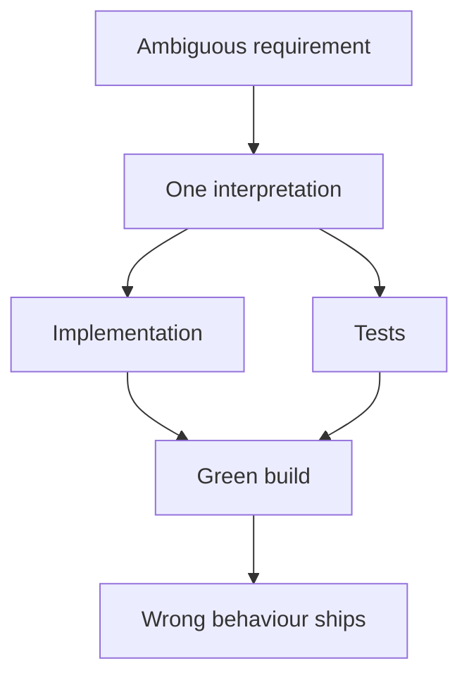

Coding agents now write the implementation, the unit tests, and often the integration test for the same change, then repair the failures until everything is green. This is usually described as a safety improvement. In one specific way, it is the opposite.

When one agent interprets the requirement, writes the code, and writes the tests, a passing suite proves that the code agrees with the agent's interpretation. It does not prove the interpretation was right. If it was wrong, the code and the tests are wrong together, in exactly the same way.

## Twenty tests, one misunderstanding

Suppose a requirement says customers can cancel an order "before fulfilment." An agent reads that as "before shipping," implements it, and generates tests for pending and shipped orders. Everything passes. The actual product rule prohibits cancellation once warehouse picking begins.

Developers have always written tests that confirm their own assumptions. What changed is scale: an agent can turn one misunderstanding into a large, polished diff with a matching suite before anyone else looks at it. Twenty generated test cases derived from one wrong assumption are still one wrong assumption.

Independent evidence has to come from outside that loop: an acceptance rule someone else wrote down, an API contract, a historical incident, a production example, a reviewer who knows the domain.

## The regression suite is memory the agent doesn't have

A mature regression suite records things nobody put in the prompt: edge cases discovered in production, contracts agreed with other systems, security boundaries, failures the team already paid to understand. An agent arriving at the repository knows none of that history. The suite makes part of it executable.

This matters because agents optimise for the requested change. A regression test is the mechanism that says: whatever you did over there, these existing properties still hold.

The practical rule is simple. Every escaped defect becomes an automated check at the layer where it escaped: sometimes a unit test, often a contract test, a migration test, or a deployment check. That is what stops the next agent from rediscovering the same failure.

## Generated unit tests hug the implementation

AI is good at generating unit tests, and the tests it generates tend to follow the shape of the code: mock every collaborator, assert internal calls, copy constants from the implementation. They pass while the system fails at its boundaries. The database mapping drops a field, the JSON property has the wrong name, the emitted event violates its schema, or the deployed route bypasses the permission check through different middleware.

So the tests that matter more in an AI-driven workflow are the ones at real boundaries: schemas, migrations, serialization, authentication wiring, event contracts. Mocking the database driver does not validate a migration. When an agent changes both sides of a boundary in one diff, only a test that neither side controls can catch the shared mistake.

## CI has to be independent of the author

An agent should run tests while it works, but it should not decide which checks are mandatory. It has incomplete context and an incentive to finish. It will pick the nearest tests, or dismiss a failing suite as unrelated to its change.

CI is the enforcement point that doesn't care who the author was: required checks, run from known configuration, against the exact revision. The pipeline also has to protect the tests themselves, with ownership rules on security checks, contract fixtures, and CI configuration, because the cheapest way to make a change green is to weaken the evidence that was supposed to constrain it.

## Coverage is not confidence

AI can raise coverage quickly, and coverage measures what ran, not whether any assertion would catch a defect. A test can execute every line while duplicating the implementation's calculation.

The questions worth asking of a generated test: would it fail if the business rule were reversed? Was the expected value derived from anything other than the code under test? Has anyone ever seen it fail? Mutation testing answers the first question mechanically and is worth pointing at suites an agent produced.

## Where to start

- Hold AI-authored changes to the same mandatory pipeline as human ones.
- Turn escaped defects into regression checks at the layer where they escaped.
- Put realistic integration or contract coverage on the boundaries that hurt: data, auth, payments, irreversible operations.
- Give agents acceptance examples and contracts up front, instead of letting them infer the expected behaviour from the code they just wrote.
- Watch escaped defects and rework, not how fast the build goes green.

Producing a plausible change is becoming cheap. Independently proving the change is correct is the part that still separates teams, and it is the job that regression suites, boundary tests, and author-independent CI exist to do.
