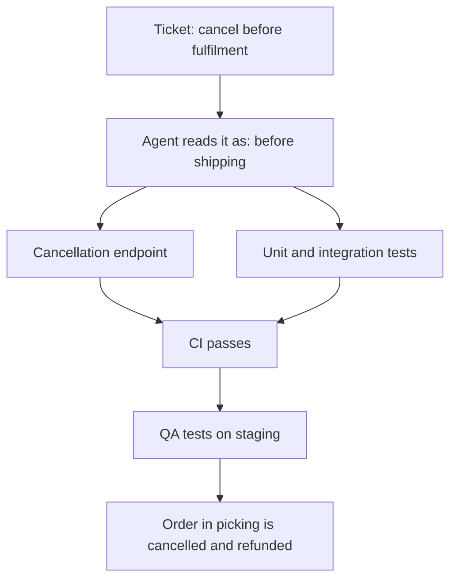

A coding agent writes the implementation and the tests for a change, then fixes failures until CI passes. The code and the tests come from the same reading of the ticket. If that reading is wrong, both are wrong and CI still passes.

## How Does A Wrong Change Pass CI?

A ticket for a grocery app says customers can cancel an order "before fulfilment". An agent reads this as "before the order ships" and writes tests for pending and shipped orders. Every test passes.

The operations team uses "fulfilment" to mean picking. Once a picker starts on an order, it cannot be cancelled. That rule is not in the repository.

## What Does A QA Check?

A QA asks the operations lead what "fulfilment" means. Then they place an order on staging, start picking it in the warehouse tool, and press Cancel on a phone. Their test plan has these cases:

- cancel a pending order
- cancel an order in picking
- cancel an order after the delivery slot cutoff
- cancel one of two orders placed in the same checkout
- press Cancel twice on a slow mobile connection

Only the first case is in the ticket. The QA knows the others from earlier releases and support tickets. The double press often finds duplicate refunds.

An agent does not ask the operations lead what a word means, and it has no record of last year's incidents. A developer who tests their own code has the same problem on a smaller scale.

## Should Developers Still Test By Hand?

Yes. Run every agent-written change locally before opening a merge request: the main flow and one or two error cases. This finds broken screens, wrong copy, and errors that the agent hid behind a fallback value. An agent's diff is often large and tidy, and reviewers approve code that reads well. Running the feature shows what the code does.

The developer checks that the change works. The QA checks that it meets the business requirement.

## Why Write Down The Regression Journeys?

A regression catalog is a document in the repository. It lists the core user journeys, with one action and one expected result per case:

| ID | Action | Expected |
| --- | --- | --- |
| ORD-07 | Cancel an order in picking | Cancel button is disabled, with the message "This order is being packed" |
| ORD-08 | Press Cancel twice on a pending order | One cancellation and one refund |

Keep these rules for the catalog:

- Cover journeys a customer or staff member takes. Leave out visual details.
- Keep case IDs stable, so tickets, tests and bug reports can refer to them.
- Update the catalog in the same merge request as any change to user-visible behaviour.
- Name the test data for each case, such as a seeded account with a full order history.

The agent reads the catalog before it starts. The QA walks the same cases on staging. The end-to-end tests use the same IDs. Without the catalog, the agent infers the expected behaviour from the code.

## How Should Agents Use Playwright And Screenshots?

An agent can write [Playwright](https://playwright.dev/) tests and run them. Have it write them from the catalog cases. A test written from the new code checks only what the code already does.

The agent can also walk a journey in a browser and take a screenshot at each step. Use `toHaveScreenshot` to fail a test when a screen differs from the approved baseline.

A screenshot of a successful cancellation looks correct even when the order was in picking. A person still compares the result with the requirement.

Set limits on these tests:

- An agent can run `--update-snapshots` to make a failing visual test pass. Require human review of baseline changes.
- Agents fix flaky tests with fixed waits and retries. Require locators by role and label, such as `getByRole('button', { name: 'Cancel order' })`.
- Take screenshots with seeded data. An empty account hides overflow and pagination bugs.

## What Should A Merge Request Description Show?

A merge request description that only lists the changed files tells the reviewer nothing about behaviour. Have the agent write the description with the before and after state of each affected journey:

| Case | Before | After |
| --- | --- | --- |
| ORD-07 Cancel an order in picking | Order is cancelled and refunded (screenshot) | Cancel button is disabled, with the message "This order is being packed" (screenshot) |
| ORD-08 Press Cancel twice | Two refunds issued | One refund issued |
| ORD-03 Cancel a pending order | Order is cancelled | No change |

Include these items:

- The catalog case IDs the change affects, and the cases checked for no change.
- Screenshots from the target branch and from the change, taken with the same seeded data.
- API request and response samples when the change has no screen, such as a new error code.
- The steps and test data used, so the QA can repeat them on staging.

The reviewer compares the before and after states with the ticket before reading the diff. A wrong reading of the requirement shows up in the "After" column. The QA starts from the same table. After the merge, the description is a record of what the release changed, and the next agent can read it when it touches the same journey.

## What Do Automated Regression Tests Still Do?

Every bug that reaches staging or production gets an automated test at the layer where it escaped: unit, API contract, database migration or end-to-end. CI then runs it on every change.

Agent-generated unit tests mock every dependency and copy constants from the implementation. They pass while the database mapping drops a field or the API returns the wrong property name. Tests that run real migrations, check the API contract and call deployed routes find these bugs.

## What Should The Release Process Look Like?

1. The product owner writes acceptance examples in the ticket, with real order statuses.
2. The agent gets the examples, the regression catalog and the API contracts in its prompt.
3. The agent updates the catalog and the Playwright tests for any changed journey.
4. The developer tests the change by hand.
5. The merge request description shows the before and after state of each affected case, with screenshots.
6. CI runs the required suite.
7. The QA walks the affected catalog cases on staging.
8. Every bug found in steps 4 to 7 becomes a catalog case and an automated test.

The QA step adds about half a day to a feature. In the cancellation example, skipping it means refunds on picked orders and stock written off in the warehouse.
